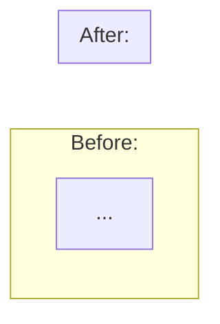
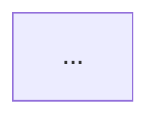
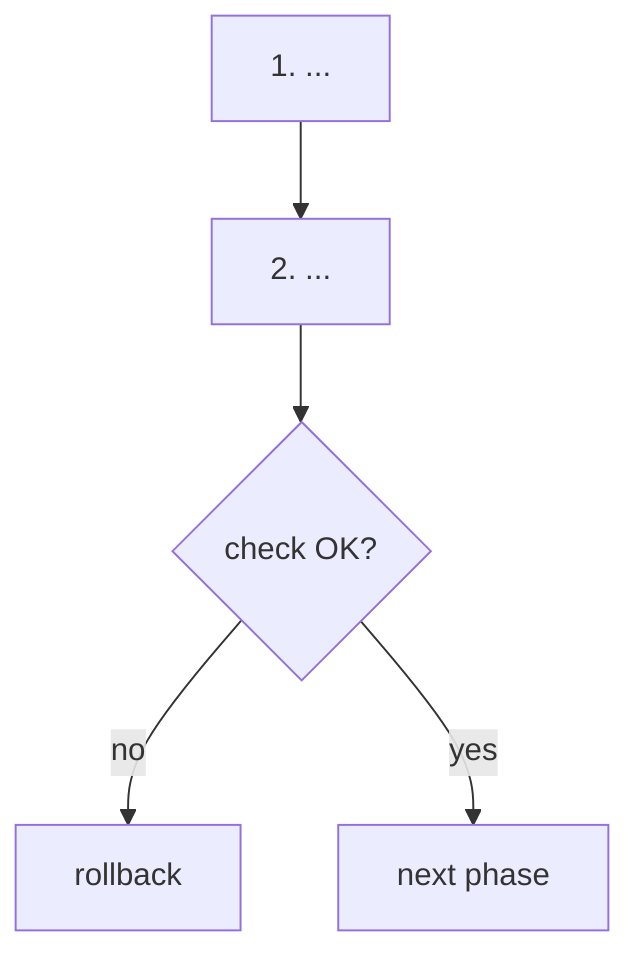

# Feature Doc Template

Skeleton for `core_docs_dir/feature-{name}.md`. Sections marked *(optional — …)* appear only
when their condition holds; delete them otherwise. Never leave an empty section or a placeholder.

````markdown
# <Feature Title: what changed, in plain words>

**ADW ID:** <adw_id — omit line if none>
**Date:** <YYYY-MM-DD>
**Specification:** `<spec_path>` <or "N/A">
**Branch:** `<branch>`
**Status:** <what is done (phases, migrations, flags) and what is not done yet>

## Overview

<Paragraph 1 — the problem: what the system does today and why that is slow, wrong, or missing.>

<Paragraph 2 — the solution: what this feature adds, in one or two sentences.>

<Paragraph 3 — the switch, if any: flag/config name, what it selects, what stays for rollback.>

<Paragraph 4 — the headline result with real numbers (before → after, conditions of the test).>

## Screenshots

*(optional — include only when `screenshots_dir` was provided)*


---

## Terms

*(optional — include when the doc uses domain or infrastructure terms a new team member may not know)*

### <Term 1>

<What it is, in 2-4 sentences. Then how it applies in this feature — sizes, limits, config values.>

### <Term 2>

- <Bullet facts when the term has several parts>

---

## Why we need it

*(optional — include when the feature fixes a measured problem or changes a design)*



- <Where in the code the problem happens (`path/file.py`, function)>
- <Why the old design costs more>
- <Why the new design costs less>

### Measured <where: local / env, data size, cache state>

| Variant | <metric A> | <metric B> |
|---|---|---|
| <old> | ... | ... |
| <new> | ... | ... |

<One line on side costs that did not change or got worse (write cost, disk size, memory).>

---

## What Was Built

- **<Component>** `<path or name>`: <what it does, one line>
- **Fix** in `<path>`: <what bug it removes and why it was needed>

---

## Technical Implementation

### <Flow 1, e.g. write path>

```mermaid
sequenceDiagram
    ...
```

- <What changed in this flow, and what did not>

### <Flow 2, e.g. read path / decision point>



<If a new module exposes several functions, add a table:>

| Function | <mode A> | <mode B> | Used by |
|---|---|---|---|
| `fn()` | ... | ... | ... |

Design decisions:

- **<Decision>.** <Why — the trade-off or failure it avoids.>

### Files Modified

- `<file_path>`: <what was changed/added>

### Key Changes

- <3-5 bullets — the most important technical changes>

---

## How to Use

<For simple features: numbered steps. For rollouts / migrations / multi-step operations, use the
structure below.>

<One-line order rule, e.g. "Do the steps in this order. Do not <X> before <Y>.">



### Step 1. <Action>

```bash
<exact command>
```

- **What it does:** <effect>
- **Why:** <why this step, and why at this position in the order>
- **Check:** <how to confirm it worked — expected output>
- **Risk:** <locks, downtime, side effects — omit if none>

### Lessons from <environment> rollout (<date>)

*(optional — include after a real rollout found surprises)*

- **<Surprise>.** <What happened and what to do instead.>

### Rollout state per environment

*(optional — include when the feature is enabled per environment)*

| Environment | Config file | Preparation | Flag |
|---|---|---|---|
| <env> | `<file>` | <done YYYY-MM-DD / not done> | <on/off> |

Update this table when an environment changes.

### Cases: how to enable in an environment

*(optional — include when there is more than one valid way to turn the feature on)*

**Case 1: <name> (<current / recommended>).**

1. <step>

<Risk of this case in one or two sentences.>

**Rollback in every case:** <exact action and its effect>.

## Configuration

| Name | Default | Meaning |
|---|---|---|
| `<ENV_VAR or --flag>` | <default> | <effect, accepted values> |

## Testing

```bash
# <what this test proves>
<command>
```

## Notes

- **<Risk or limit, stated first>.** <Detail and how to avoid it.>
- **<Next phase> (not done):** <what it does, whether it is one-way, approval needed>.
- Related spec<, not implemented>: `<path>` (<one line>).
````
